# Enabling Intelligent Query Resolution: A wxO–ServiceNow Integration

## Table of Contents
- [About](#about)
- [Overview](#overview)
- [Solution Architecture](#solution-architecture)
  - [Architecture Diagram](#architecture-diagram)
  - [Component Interaction Flow](#component-interaction-flow)
- [Project Structure](#project-structure)
- [Prerequisites](#prerequisites)
- [Implementation Guide](#implementation-guide)
  - [Step 1: Create Software Procurement Advisor Agent](#step-1-create-software-procurement-advisor-agent)
  - [Step 2: Setup ServiceNow Connection](#step-2-setup-servicenow-connection)
  - [Step 3: Create Python Tools](#step-3-create-python-tools)
  - [Step 4: Import Tools Using import.sh Script](#step-4-import-tools-using-importsh-script)
  - [Step 5: Create NSR Agentic Workflow Tool](#step-5-create-nsr-agentic-workflow-tool)
  - [Step 6: Add Behaviour in Agent](#step-6-add-behaviour-in-agent)
- [How to Use the Agent](#how-to-use-the-agent)
- [Summary](#summary)

---

## About
This Technical Blog focuses on integration of **watsonx Orchestrate** and **ServiceNow** to enable **Intelligent Query Resolution** for software procurement. Also, show the capabilities of **Agentic Workflow builder.**

## Overview

This solution focuses on building an **AI-powered Software Procurement Agent** that enables intelligent discovery and retrieval of software information from an enterprise system.

The **watsonx Orchestrate agent** is designed to accept **natural language queries** from users and translate them into structured retrieval operations. It is integrated with a **ServiceNow instance,** which serves as the backend system of record for software inventory.

To bridge the gap between unstructured user queries and structured enterprise data, the system leverages **Prompt engineering** to interpret user intent + **Custom Python tools** to query and retrieve relevant records.

### The solution supports two distinct procurement workflows:

- **Standard Software Requests:** For pre-approved software, where the agent directly provides relevant details and procurement links.

- **Non-Standard Software Requests:** For software outside the approved list, where the agent guides users through additional request or approval steps.

---

## Solution Architecture

### Architecture Diagram

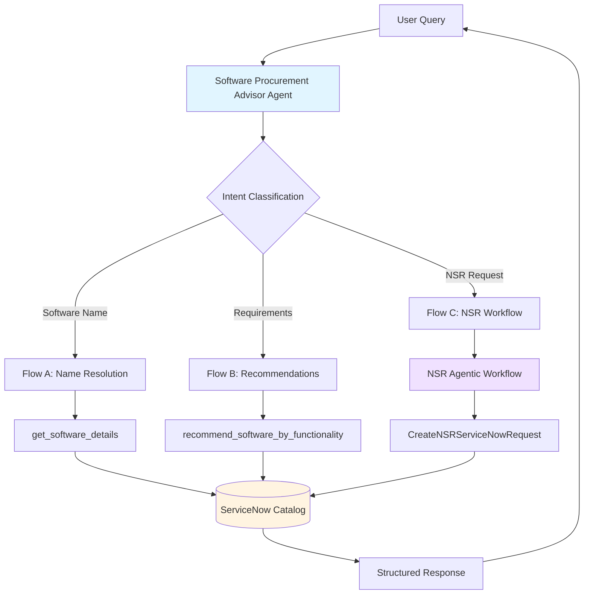

### Component Interaction Flow

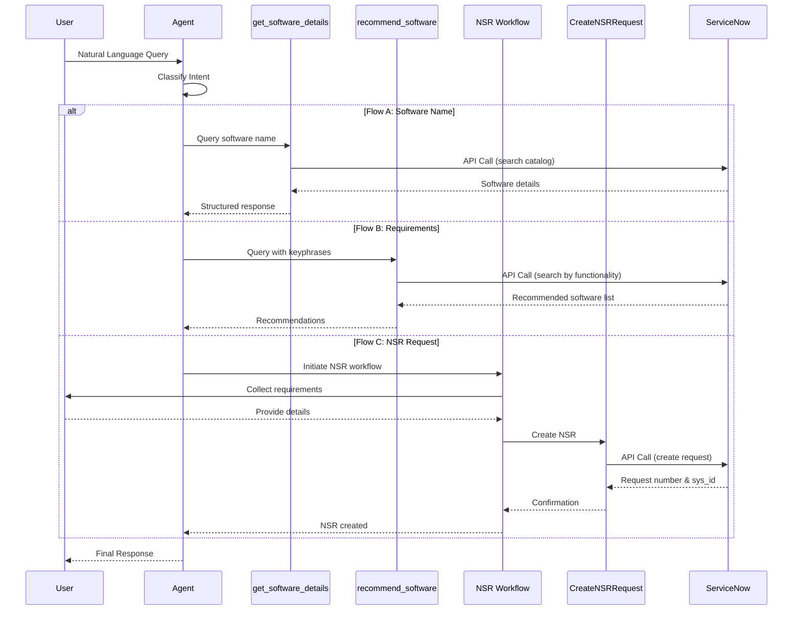

---

## Project Structure

```
software_procurement_advisor/
├── agents/
│   └── native/
│       └── Software_Procurement_Advisor_6689eB.yaml
├── connections/
│   └── ServiceNow_Auth.yaml
├── tools/
│   ├── get_software_details/
│   │   ├── get_software_details.py
│   │   ├── software_names.txt
│   │   ├── requirements.txt
│   │   └── tool-spec.json
│   ├── recommend_software_by_functionality/
│   │   ├── get_software_recommendations.py
│   │   ├── software_names.txt
│   │   ├── requirements.txt
│   │   └── tool-spec.json
│   ├── CreateNSRServiceNowRequest/
│   │   ├── service_now_request_creation_new.py
│   │   ├── requirements.txt
│   │   └── tool-spec.json
│   └── NSR_workflow_1418uw/
│       └── NSR_workflow_1418uw.json
└── import.sh (in parent directory)
```

---

## Prerequisites

**Required Software:**
- Python 3.8+
- ibm-watsonx-orchestrate==2.0.0
- rapidfuzz

**Required Access:**
- ServiceNow instance with API access
- ServiceNow credentials (username & password)
- watsonx Orchestrate account

**Setup Resources:**
- [watsonx Orchestrate ADK](https://developer.watson-orchestrate.ibm.com/tools/create_tool#importing-individual-python-tools)
- [ADK Installation Guide](https://developer.watson-orchestrate.ibm.com/getting_started/installing)

---

## Implementation Guide

### Step 1: Create Software Procurement Advisor Agent
1. Navigate to the Agent Builder. Click on **Create agent**.


2. Select **Create from scratch**.

3. Give **Name** and **Description**.

4. Click on **Create** button.


You'll see **Software Procurement Advisor Agent** successfully created.


### Step 2: Setup ServiceNow Connection

Before importing tools, you need to create a connection to your ServiceNow instance. This connection will be used by all tools to authenticate and interact with ServiceNow.

#### Create ServiceNow Basic Auth Connection

The connection setup is automated through the `import.sh` script. Here's what it does:

1. **Creates the connection**: Establishes a connection named `ServiceNow_Auth`
2. **Configures environments**: Sets up both Draft and Live environments
3. **Sets credentials**: Configures username and password for ServiceNow authentication

```bash
# Create connection
orchestrate connections add -a ServiceNow_Auth

# Configure Draft Environment
orchestrate connections configure \
  -a ServiceNow_Auth \
  --env draft \
  --kind basic \
  --type team

# Set Draft Credentials
orchestrate connections set-credentials \
  -a ServiceNow_Auth \
  --env draft \
  -u <servicenow_username> \
  -p <servicenow_password>

# Configure Live Environment
orchestrate connections configure \
  -a ServiceNow_Auth \
  --env live \
  --kind basic \
  --type team

# Set Live Credentials
orchestrate connections set-credentials \
  -a ServiceNow_Auth \
  --env live \
  -u <servicenow_username> \
  -p <servicenow_password>

# Verify Connections
orchestrate connections list
```

**Important**: Replace `<servicenow_username>` and `<servicenow_password>` with your actual ServiceNow credentials before running the script.

### Step 3: Create Python Tools

All three Python tools use the `ServiceNow_Auth` connection created in Step 2 to interact with the ServiceNow catalog.

### 1. **get_software_details** Tool

> **Purpose**: Validates software existence in ServiceNow catalog and retrieves comprehensive details with intelligent name matching.

**What it does**: When a user requests information about specific software, this tool searches the ServiceNow catalog, automatically corrects misspellings using fuzzy matching, and returns detailed information including pricing, description, and procurement links.

#### Tool Flow Diagram

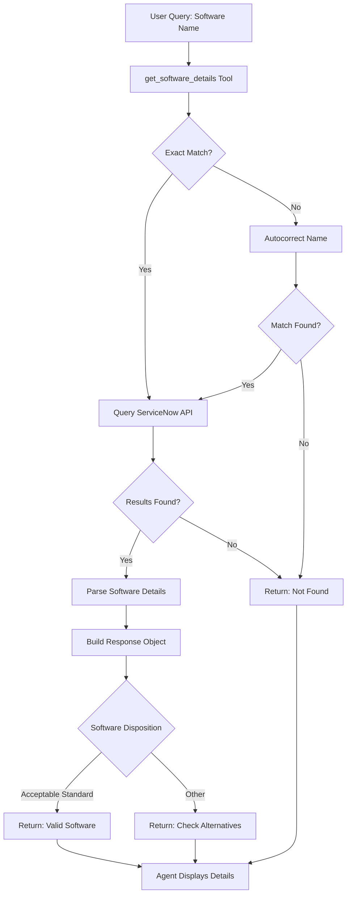

**Key Features:**
- **Fuzzy Name Matching**: Uses `rapidfuzz` library to autocorrect misspelled software names (75% threshold)
- **ServiceNow Integration**: Queries the ServiceNow catalog API with basic authentication
- **Structured Response**: Returns software details including name, description, cost, and installation link
- **Fallback Mechanism**: Attempts autocorrection if exact match fails

#### Tool Configuration

Registers the tool with watsonx Orchestrate and defines authentication requirements:

```python
@tool(
    name="get_software_details",
    description="Check if software exists in ServiceNow catalog",
    permission=ToolPermission.ADMIN,  # Requires admin permission
    expected_credentials=[
        {
            "app_id": "ServiceNow_Auth",  # Uses ServiceNow connection
            "type": ConnectionType.BASIC_AUTH  # Basic auth credentials
        }
    ]
)
def resolve_software_and_disposition(
    software_name: str,              # User's software query
    catalog_id: str = DEFAULT_CATALOG_ID,  # ServiceNow catalog ID
) -> ResolveSoftwareResponse:        # Structured response object
```

**Key Points:**
- Tool requires admin permissions for security
- Automatically retrieves ServiceNow credentials from connection
- Accepts software name and optional catalog ID as inputs

#### Intelligent Name Correction

Handles typos and variations in software names using fuzzy string matching:

```python
def autocorrect_name(name: str, threshold: int = 75) -> str:
    """
    Corrects misspelled software names using fuzzy matching
    - Loads canonical names from software_names.txt reference file
    - Uses rapidfuzz library with WRatio algorithm for similarity scoring
    - Returns corrected name if similarity >= 75%, otherwise original
    - Example: "Adobee Photshop" → "Adobe Photoshop"
    """
```

**Why This Matters:** Users often misspell software names. This function ensures queries succeed even with typos, improving user experience.

#### ServiceNow API Integration

Performs intelligent catalog search with automatic fallback:

```python
def servicenow_lookup_with_fallback(name, catalog_id, base_url, auth):
    """
    Two-stage search strategy:
    1. Primary: Exact name match in ServiceNow catalog
    2. Fallback: If no results, retry with autocorrected name
    
    Returns: List of matching catalog items with full details
    API Endpoint: /api/now/table/sc_cat_item
    Query Fields: name, description, price, disposition, metadata
    """
```

**Smart Search:** Maximizes success rate by trying both exact and corrected names, reducing "not found" errors.

#### Response Structure

Comprehensive response model containing all software information:

```python
class ResolveSoftwareResponse(BaseModel):
    valid_software: bool = False           # True if software found in catalog
    original_software: str = ""            # User's original query
    original_disposition: str = ""         # Software approval status
    Valid_Software: List[SoftwareEntry] = []  # Matching software details
    ALT_Standard: List[SoftwareEntry] = []    # Alternative approved options
```

**Response Fields Explained:**
- `valid_software`: Quick boolean check for software existence
- `original_disposition`: Indicates if software is approved, restricted, or unavailable
- `Valid_Software`: Contains all matching software with pricing, links, and descriptions
- `ALT_Standard`: Provides approved alternatives if requested software isn't standard

**Full implementation:** See [`software_procurement_advisor/tools/get_software_details/get_software_details.py`](./software_procurement_advisor/tools/get_software_details/get_software_details.py)


### 2. **recommend_software_by_functionality** Tool

> **Purpose**: Discovers and recommends approved software based on user's functional requirements and use cases.

**What it does**: When users describe what they need (e.g., "video editing tool" or "project management software"), this tool intelligently searches the catalog using AI-generated keyphrases and inferred software names, returning only pre-approved "acceptable standard" options that match their requirements.

#### Tool Flow Diagram

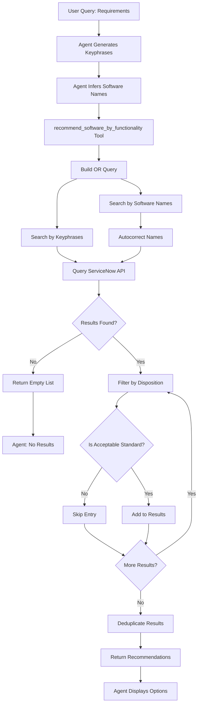

**Key Features:**
- **Multi-criteria Search**: Searches by keyphrases in descriptions/metadata AND software names
- **Fuzzy Matching**: Autocorrects software names for better results
- **Disposition Filtering**: Returns only "acceptable standard" software
- **Deduplication**: Removes duplicate entries
- **Iterative Recommendations**: Maintains exclusion list to avoid repeating suggestions

#### Tool Configuration

Accepts multiple search criteria for flexible software discovery:

```python
@tool(
    name="recommend_software_by_functionality",
    description="Recommend acceptable standard software using ServiceNow catalog",
    permission=ToolPermission.ADMIN,
    expected_credentials=[
        {
            "app_id": "ServiceNow_Auth",
            "type": ConnectionType.BASIC_AUTH
        }
    ],
)
def recommend_software_by_functionality(
    software_functionality: str = "",  # User's requirement description
    keyphrases: List[str] = None,     # AI-generated search terms
    software_names: List[str] = None, # AI-inferred product names
) -> RecommendationResponse:
```

**Input Strategy:**
- `software_functionality`: Original user query (e.g., "I need video editing software")
- `keyphrases`: Agent generates 15+ relevant terms (e.g., "video-editing", "multimedia", "content-creation")
- `software_names`: Agent infers commercial products (e.g., "Adobe Premiere", "Final Cut Pro")

#### Multi-Criteria Search Engine

Builds comprehensive OR query to maximize relevant results:

```python
def fetch_servicenow_candidates(keyphrases, software_names):
    """
    Intelligent search combining multiple strategies:
    
    1. Keyphrase Matching:
       - Searches in 'description' field for feature mentions
       - Searches in 'u_meta_data' field for tags/keywords
       
    2. Name Matching:
       - Exact name search in catalog
       - Autocorrected name search (handles typos)
       
    3. Active Filter:
       - Only returns currently available software
    
    Query Example:
    "descriptionLIKEvideo-editing^ORu_meta_dataLIKEvideo-editing^
     ORnameLIKEAdobe Premiere^active=true"
    """
    sysparm_query = "^OR".join(query_parts) + "^active=true"
```

**Why This Works:** Casts a wide net using multiple search angles, then filters results to ensure quality.

#### Approval Status Filtering

Ensures only pre-approved software is recommended:

```python
ALLOWED_DISPOSITIONS = {"acceptable standard"}

# Strict filtering during result processing
for item in results:
    disposition = item.get("u_software_disposition", "").strip().lower()
    
    if disposition not in ALLOWED_DISPOSITIONS:
        continue  # Skip non-approved software
    
    # Only approved software reaches the user
```

**Security Benefit:** Prevents users from discovering or requesting non-compliant software, maintaining IT governance.

#### Response Structure

Simple list of approved recommendations:

```python
class RecommendationResponse(BaseModel):
    recommended_software: List[SoftwareEntry] = []
    # Each entry contains: name, description, price, link, disposition
```

**Agent Behavior:**
- Displays all recommendations in markdown tables
- Maintains exclusion list across iterations to avoid repeats
- Offers to find more options or raise NSR if nothing fits

**Full implementation:** See [`software_procurement_advisor/tools/recommend_software_by_functionality/get_software_recommendations.py`](./software_procurement_advisor/tools/recommend_software_by_functionality/get_software_recommendations.py)


### 3. **CreateNSRServiceNowRequest** Tool

> **Purpose**: Automates the creation of Non-Standard Software Requests (NSR) in ServiceNow for unapproved software.

**What it does**: When users need software that's not in the approved catalog, this tool collects all necessary information (software details, business justification, urgency, etc.) and automatically submits a formal NSR ticket in ServiceNow for review and approval, providing users with a tracking number and confirmation.

#### Tool Flow Diagram

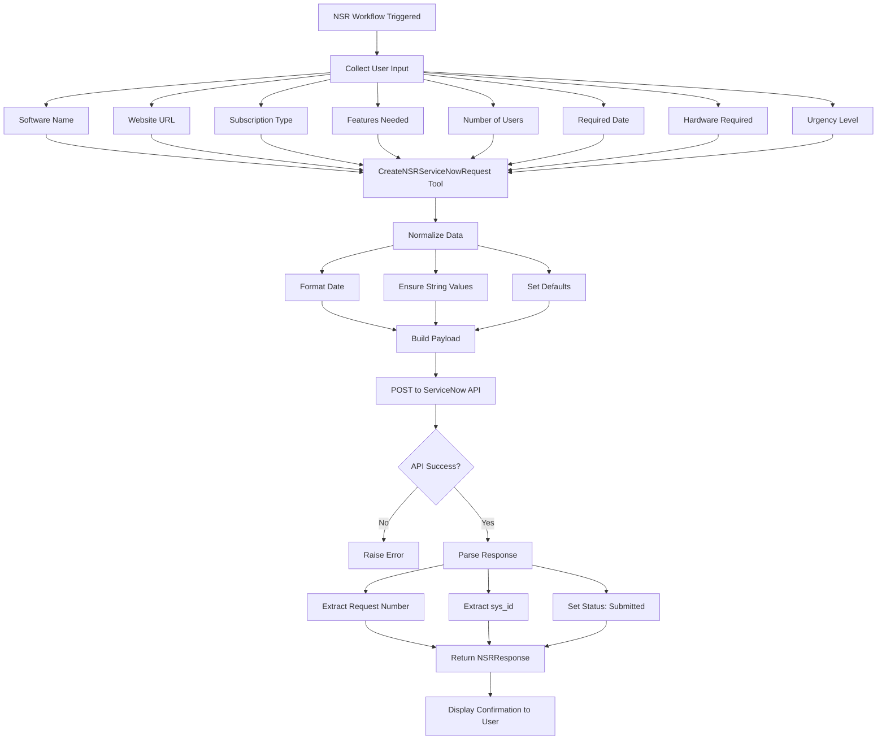

**Key Features:**
- **8 Required Fields**: Collects comprehensive information for NSR submission
- **ServiceNow API Integration**: Uses ServiceNow Service Catalog API to create requests
- **Data Normalization**: Ensures all fields have valid values before submission
- **Structured Response**: Returns request number, sys_id, and status
- **Error Handling**: Validates API response and raises errors for failures

#### Tool Configuration

Requires write permissions to create tickets in ServiceNow:

```python
@tool(
    permission=ToolPermission.READ_WRITE,  # Write access needed for ticket creation
    expected_credentials=[
        {"app_id": "ServiceNow_Auth", "type": ConnectionType.BASIC_AUTH}
    ]
)
def CreateNSRServiceNowRequest(nsr_params: NSRRequestInput) -> str:
    """
    Creates a formal Non-Standard Software Request ticket
    Returns: JSON string with request number, sys_id, and status
    """
```

**Permission Note:** Unlike read-only tools, this requires READ_WRITE to modify ServiceNow data.

#### Comprehensive Input Schema

Collects all information needed for procurement approval:

```python
class NSRRequestInput(BaseModel):
    software: str                    # Software name (REQUIRED)
    website: Optional[str]           # Vendor website for verification
    urgency: Optional[str]           # Business priority (1-Critical, 2-High, 3-Moderate, 4-Low)
    subscription: Optional[str]      # Licensing model (SaaS, On-Prem, Perpetual)
    features: Optional[str]          # Business justification - why this software?
    no_of_users: Optional[int]       # License count for cost estimation
    date: Optional[datetime]         # When software is needed (project deadline)
    hardware_required: Optional[str] # Additional infrastructure needs (Yes/No)
```

**Data Collection Strategy:**
- Workflow collects these fields interactively through conversational UI
- Branching logic: SaaS path asks for users/date, On-Prem path asks for hardware
- All fields normalized before API submission (defaults applied, dates formatted)

#### ServiceNow Service Catalog API

Creates request using official ServiceNow REST API:

```python
# API Endpoint for catalog item ordering
url = f"{base_url}/api/sn_sc/servicecatalog/items/{CATALOG_ITEM_SYS_ID}/order_now"

# Request payload structure
payload = {
    "sysparm_quantity": "1",                    # Single software request
    "sysparm_requested_for": "<user_sys_id>",  # Requester's ServiceNow user ID
    "sysparm_no_validation": "true",           # Skip client-side validation
    "variables": {
        "software": ensure_string(raw.get("software")),
        "website": ensure_string(raw.get("website")),
        "urgency": ensure_string(raw.get("urgency"), "3 - Moderate"),
        "subscription": ensure_string(raw.get("subscription")),
        "u_features": ensure_string(raw.get("features")),
        "num_licenses": str(raw.get("no_of_users", 0)),
        "date": date_str,  # Formatted as YYYY-MM-DD
        "hardware_required": ensure_string(raw.get("hardware_required"), "No"),
    }
}
```

**API Details:**
- Endpoint: `/api/sn_sc/servicecatalog/items/{catalog_item_id}/order_now`
- Method: POST
- Auth: Basic Authentication
- Response: Request number, sys_id, and initial status

#### Structured Response

Returns tracking information for the created request:

```python
class NSRResponse(BaseModel):
    request_number: str  # Human-readable ID (e.g., "REQ0012345")
    sys_id: str         # System UUID for API queries
    status: str         # Request status (default: "Submitted")
```

**User Experience:**
- Request number displayed in confirmation message
- Users can track request in ServiceNow using this number
- IT team receives notification for review and approval

**Full implementation:** See [`software_procurement_advisor/tools/CreateNSRServiceNowRequest/service_now_request_creation_new.py`](./software_procurement_advisor/tools/CreateNSRServiceNowRequest/service_now_request_creation_new.py)

### Step 4: Import Tools Using import.sh Script

After setting up the ServiceNow connection, use the provided `import.sh` script to import all tools and the agent into watsonx Orchestrate.

The script automates the following imports:

```bash
# Import NSR ServiceNow Request Tool
orchestrate tools import \
  -k python \
  -f tools/CreateNSRServiceNowRequest/service_now_request_creation_new.py \
  -p tools/CreateNSRServiceNowRequest \
  --app-id ServiceNow_Auth

# Import Software Recommendation Tool
orchestrate tools import \
  -k python \
  -f tools/recommend_software_by_functionality/get_software_recommendations.py \
  -p tools/recommend_software_by_functionality \
  --app-id ServiceNow_Auth

# Import Software Details Tool
orchestrate tools import \
  -k python \
  -f tools/get_software_details/get_software_details.py \
  -p tools/get_software_details \
  --app-id ServiceNow_Auth

# Import NSR Workflow
orchestrate tools import \
  -k flow \
  -f tools/NSR_workflow_1418uw/NSR_workflow_1418uw.json

# Import Software Procurement Advisor Agent
orchestrate agents import \
  -f agents/native/Software_Procurement_Advisor_6689eB.yaml
```

**To run the import script:**

```bash
cd /path/to/software_procurement_advisor
bash ../import.sh
```

**Note**: Ensure you have:
- Installed watsonx Orchestrate ADK (`ibm-watsonx-orchestrate==2.0.0`)
- Configured the ServiceNow_Auth connection with valid credentials
- Updated file paths in import.sh if your directory structure differs

### Step 5: Create NSR Agentic Workflow Tool

An **Agentic Workflow** has been developed to streamline the handling of **Non-Standard Software Requests (NSR)**. When software falls outside the approved catalog, this workflow automatically initiates a request in ServiceNow for proper review and approval. 

The workflow leverages a custom Python tool **CreateNSRServiceNowRequest Tool** that connects with ServiceNow to create and manage these requests, as detailed in the implementation steps below.

This is how the complete flow looks like, in this documentation we'll see how to build this.

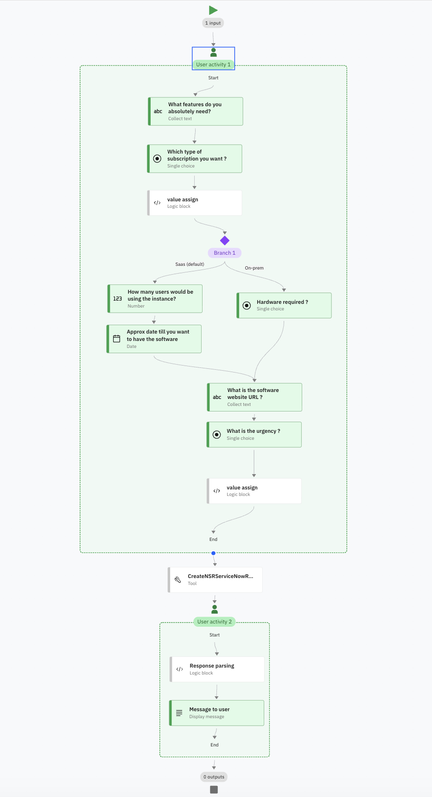

Follow the steps to build the flow:

1. On the Agent Builder screen of Agent click on **Add Tool** Button.

    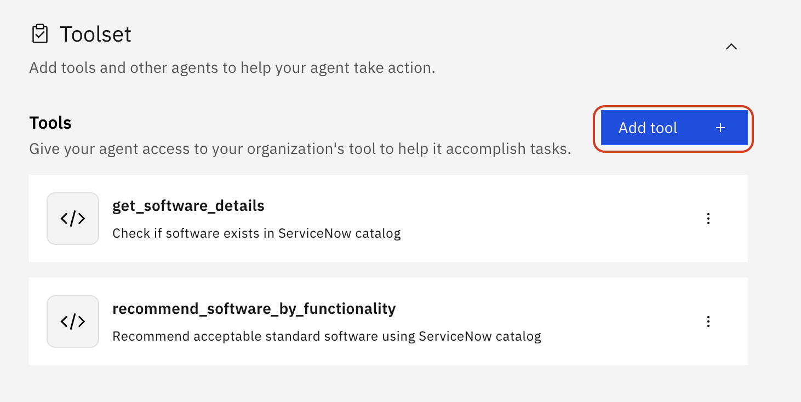

2. Select **Agentic workflow** to build workflow.
    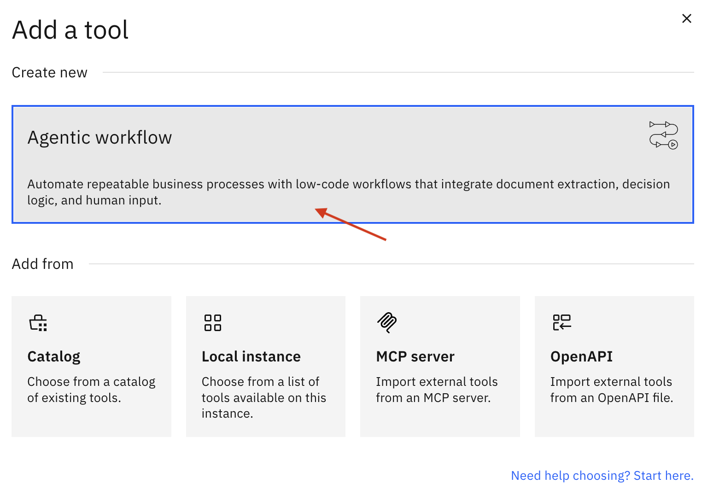

3. Enter name of your workflow and Click **Start Building.**

4. You'll reach the screen to build workflow.

    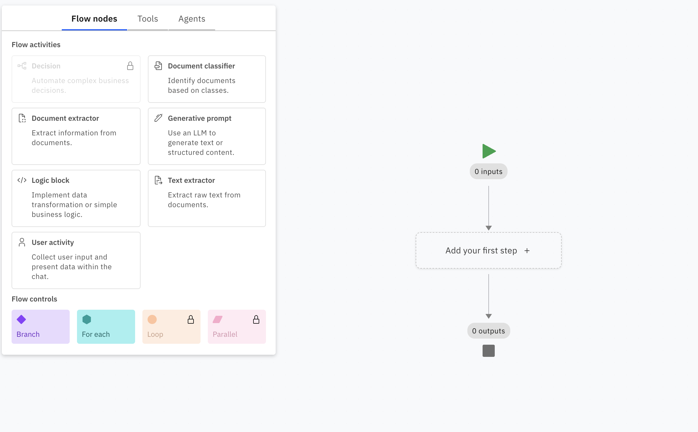

5. From the Flow nodes section on the left select **"User Activity"** block, drag it and drop on the  **Add your first step** block.

    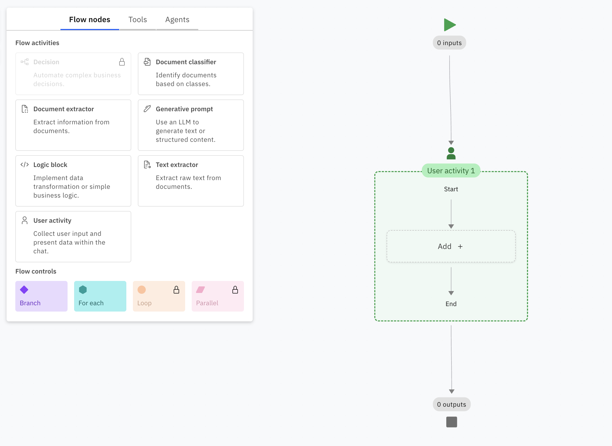

6. Enter the flow input parameters.

    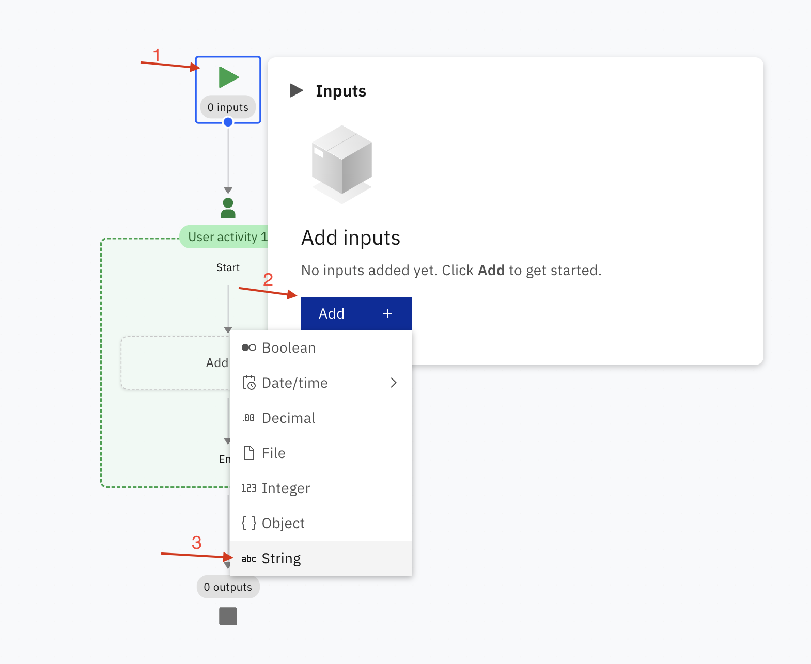

    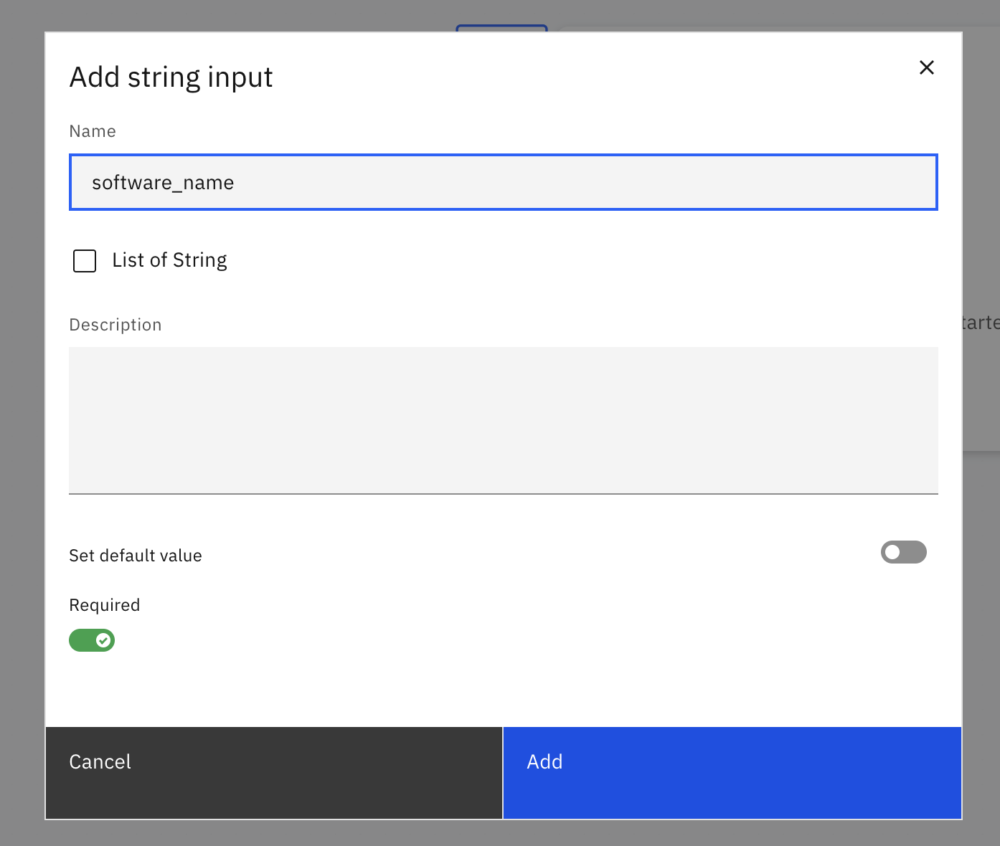

7. For the entire flow define the flow variables:
- software_name (string)
- features (string)
- subscription (string)
- no_of_users (integer)
- approx_date (datetime)
- hardware (string)
- website (string)
- urgency (string)
- user_message_md (string)
- SNOW_Response (object) with 3 object properties as shown below:

    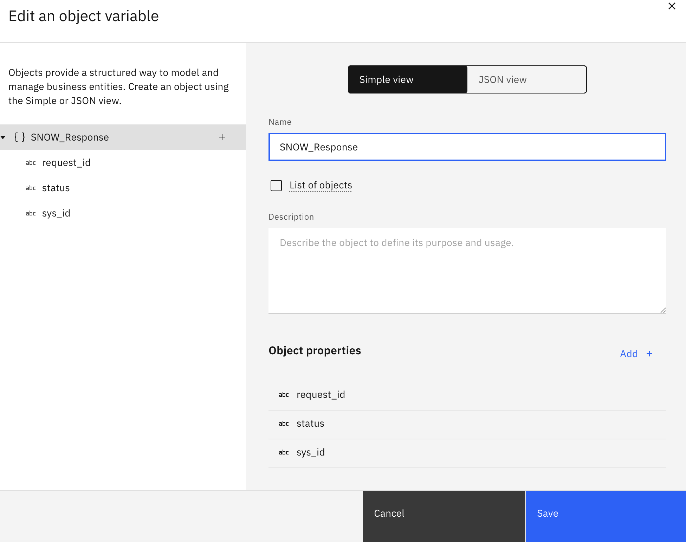

8. Select : **Add -> Collect from user -> Text**

    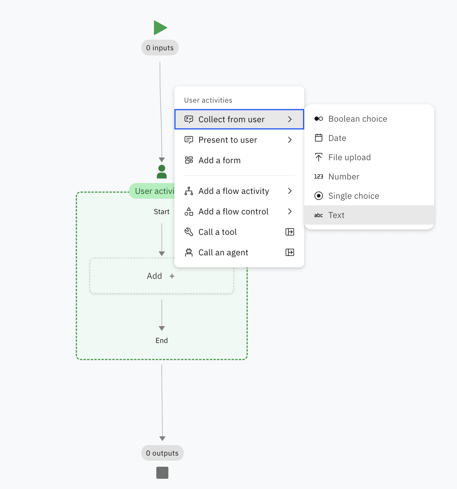

    Enter the Text/question : ```"What features do you absolutely need?"```. Then Click on anywhere on the screen.

9. For next Question, Select **Collect from user -> Single Choice**
   
   Enter the Text/question : ```"Which type of subscription you want ?"```

   Then click on ```</>``` icon to enter the choices in a list: ``` ["Saas", "On-prem"] ```. Then Click on anywhere on the screen.

10. Now we'll add the Logic Block to assign values to these variables.

    Click on **flow path line -> Click on blue plus button -> Add a flow activity -> Logic block**

    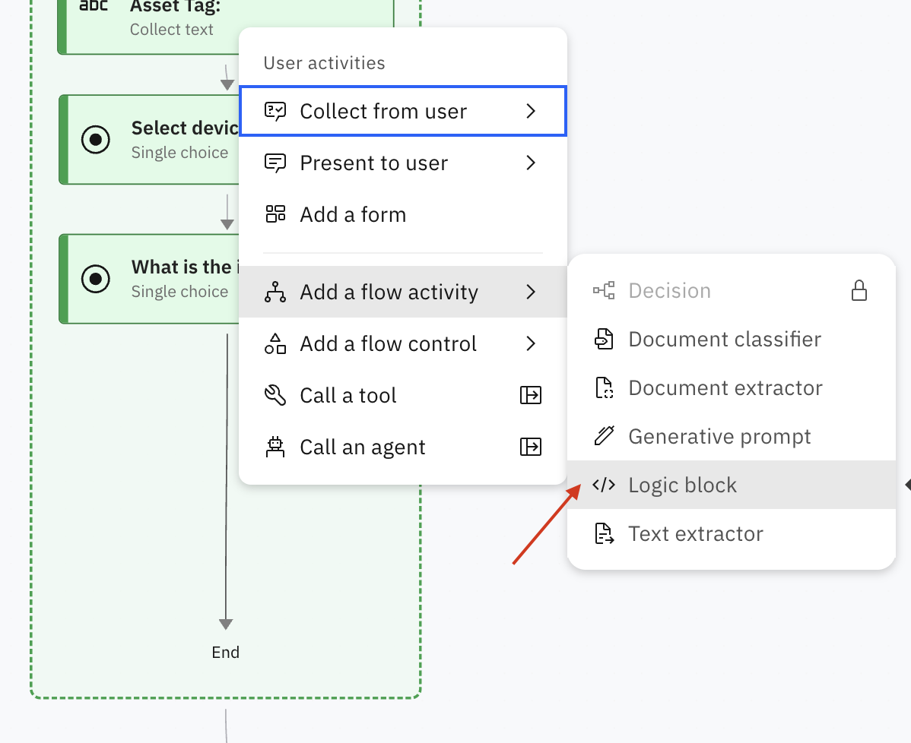

11. Give name to logic block ```Value assign```

    Click on **Open Code Editor**. Paste the below code for value assignment. Click anywhere on the screen.

    ```
    flow.private.subscription = flow["User activity 1"]["Which type of subscription you want ?"].output.value

    flow.private.features = flow["User activity 1"]["What features do you absolutely need?"].output.value
    ```

12. Next we'll add a branch to the flow. Using branch we can add conditions to our flow. For *Saas* and *On-prem* option for previous question, we'll have different flow paths.

    Click on **flow path line -> Click on blue plus button -> Add a flow control -> Branch**.

    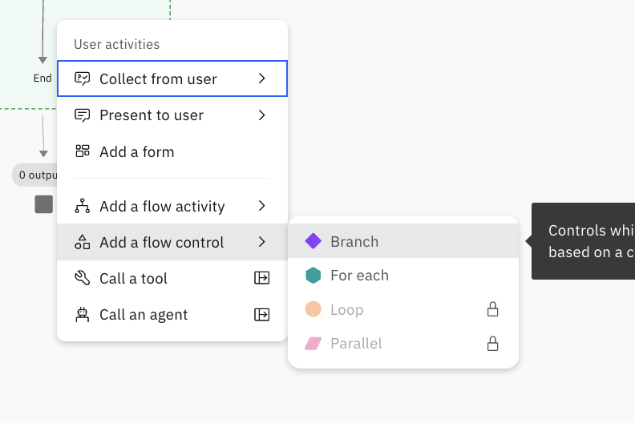

    You'll see flow paths like below image. 

    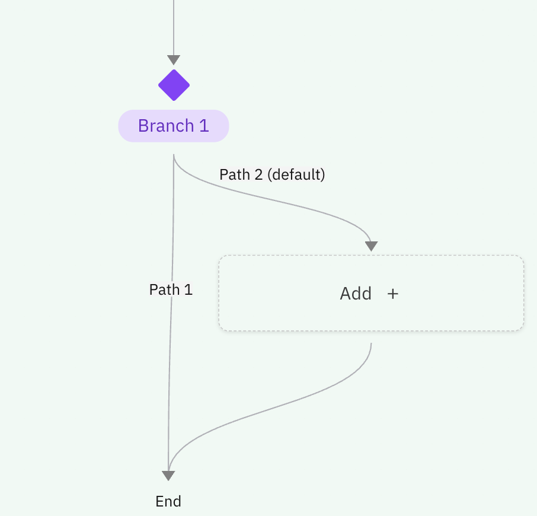

    We'll add condition to our branch as shown below:

    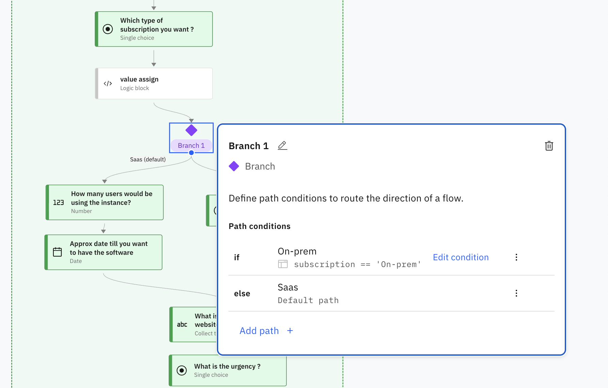

13. On the Saas option flow, we'll add a following questions:  

    -Select **Collect from user -> Number** 

    Enter text/question: ```How many users would be using the instance?```

    -Select **Collect from user -> Date** 

    Enter text/question: ```Approx date till you want to have the software?```

14. On the On-Prem option flow, we'll add a following question: 

    -Select **Collect from user -> Single Choice**
   
    Enter the Text/question : ```"Hardware required ?"```

    Then click on ```</>``` icon to enter the choices in a list: ``` ["Yes", "No"] ```.

15. Join the paths and back to the main flow and add below questions.

    -Select : **Add -> Collect from user -> Text**

    Enter the Text/question : ```"What is the software website URL ?"```. 

    -Select **Collect from user -> Single Choice**
   
    Enter the Text/question : ```"What is the urgency ?"```

    Then click on ```</>``` icon to enter the choices in a list: ``` ["High", "Medium" , "Low"] ```.

16. We'll add one more Logic Block to assign values. 

    Follow Step 8. 
    
    Add below code in the code editor.

    ```
    flow.private.website = flow["User activity 1"]["What is the software website URL ?"].output.value

    flow.private.app_date = flow["User activity 1"]["Approx date till you want to have the software"].output.value

    flow.private.hardware = flow["User activity 1"]["Hardware required ?"].output.value

    flow.private.no_of_users = flow["User activity 1"]["How many users would be using the instance?"].output.value

    flow.private.urgency = flow["User activity 1"]["What is the urgency ?"].output.value
    ```


17. After the end of **User Activity** we'll add our **CreateNSRServiceNowRequest** tool and another **User Activity 2**


18. **In User Activity 2**, We'll add Logic Block to Parse the response from Servicenow. 

    Follow Step 8. 
    
    Add below code in the code editor.
    ```
    data = json.loads(flow.CreateNSRServiceNowRequest.output)
    flow.private.SNOW_Response.sys_id= data["sys_id"]
    flow.private.SNOW_Response.request_id = data["request_number"]
    flow.private.SNOW_Response.status = data["status"]

    flow.private.user_message_md = f"""
    ### Service Request Created Successfully

    Your request has been submitted to ServiceNow with the following details:

    | Field | Value |
    |---|---|
    | **Request Number** | {flow.private.SNOW_Response.get("request_id")} |
    | **Status** | {flow.private.SNOW_Response.get("status")} |
    | **System ID** | {flow.private.SNOW_Response.get("sys_id")} |

    """
    ```

19. Select **Add -> Present to user -> Message**

    Click on ```{x}``` icon, add select Flow Variable -> **user_message_md**

    This will display the message to the user.


    **Our workflow is prepared for NSR Requests and to create a ServiceNow ticket.**

### Step 6: Add Behaviour in Agent

After creating the agent, tools, and workflow, configure the agent's behavior through system prompts. The agent uses sophisticated prompt engineering to handle three distinct procurement flows intelligently.

#### Agent Configuration

**Location:** [`software_procurement_advisor/agents/native/Software_Procurement_Advisor_6689eB.yaml`](./software_procurement_advisor/agents/native/Software_Procurement_Advisor_6689eB.yaml)

**LLM Model:** `groq/openai/gpt-oss-120b` (120B parameter model for complex reasoning)

#### Behavior Architecture

The agent's intelligence is driven by a comprehensive system prompt that defines:

**1. Intent Classification Engine**
- Semantic understanding of user queries
- Automatic routing to appropriate flow (A, B, or C)
- Handles ambiguous requests intelligently

**2. Three Distinct Flows:**

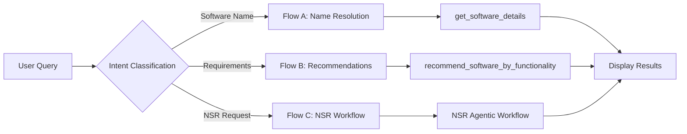

**Flow A - Software Name Resolution:**
- Triggered when user mentions specific software
- Uses `get_software_details` tool
- Handles typos with autocorrection
- Displays software details in structured tables

**Flow B - Requirements-based Recommendations:**
- Triggered when user describes needs/functionality
- Generates keyphrases and infers software names
- Uses `recommend_software_by_functionality` tool
- Maintains exclusion list for iterative searches
- Only shows pre-approved "acceptable standard" software

**Flow C - Non-Standard Software Request:**
- Triggered for unapproved software or explicit NSR requests
- Validates software first (may redirect to Flow A if found)
- Explains NSR process to user
- Launches NSR Agentic Workflow for data collection
- Creates ServiceNow ticket automatically

#### Key Prompt Engineering Features

**Global Rules:**
- Polite, professional tone
- One question at a time for clarity
- American English
- Strict markdown table formatting
- No hallucination - only catalog data

**Output Formatting:**
- Vertical tables for software details
- Smart cost extraction from descriptions
- Clickable procurement links
- Conditional field display (hide empty fields)

**Iterative Intelligence:**
- Remembers previous recommendations
- Generates new search terms for each iteration
- Prevents duplicate suggestions
- Offers alternatives or NSR when catalog exhausted

#### Importing the Agent

Use watsonx Orchestrate ADK to import the complete agent configuration:

```bash
# Import agent with all behavior and tool associations
orchestrate agents import \
  -f agents/native/Software_Procurement_Advisor_6689eB.yaml
```

This imports:
- Complete system prompt (250+ lines of behavior logic)
- Tool associations (get_software_details, recommend_software_by_functionality, NSR_workflow)
- LLM configuration
- Starter prompts for user guidance

**📄 View Complete System Prompt:** See the full behavior definition in [`Software_Procurement_Advisor_6689eB.yaml`](./software_procurement_advisor/agents/native/Software_Procurement_Advisor_6689eB.yaml) (lines 14-245: instructions field)

#### Behavior Highlights

**Intelligent Routing Example:**
- "I need Adobe Photoshop" → Flow A (name mentioned)
- "I need video editing software" → Flow B (requirement described)
- "I want to request Figma" → Flow A first (validates), then Flow C if not approved

**Smart Recommendations:**
- Generates 15+ keyphrases per query
- Infers 15+ commercial software names
- Filters by approval status
- Deduplicates results
- Maintains conversation context

**User Experience:**
- Clear, structured responses
- No technical jargon in user-facing messages
- Guided workflows for complex processes
- Transparent about catalog limitations

---

**Note:** The complete system prompt is extensive (250+ lines) and includes detailed logic for all three flows, output formatting rules, edge case handling, and conversation management. Refer to the YAML file for the full implementation.

#### System Prompt Structure Overview

The complete prompt (250+ lines) includes:

1. **Greeting Behavior** - Professional introduction and guidance
2. **Global Rules** - Tone, formatting, and data source constraints
3. **Intent Classification** - Logic for routing to appropriate flow
4. **Flow A Logic** - Software name resolution with 4 response cases
5. **Flow B Logic** - Requirements-based recommendations with iterative search
6. **Flow C Logic** - NSR request validation and workflow initiation
7. **Output Formatting Rules** - Markdown tables, cost extraction, link rendering
8. **Edge Case Handling** - Empty results, user declines, catalog exhaustion
9. **Conversation Management** - Context maintenance, exclusion lists, follow-ups

**Example Prompt Sections:**

**Intent Classification:**
```
FLOW A — Software Name Resolution
Use when: A software name is explicitly mentioned

FLOW B — Requirements → Recommendations
Use when: User describes goals, workflows, outcomes

FLOW C — Non-Standard Software (NSR) Request
Use when: User explicitly wants to raise an NSR
```

**Iterative Recommendation Logic:**
```
- Maintain INTERNAL exclusion list of previously recommended software
- Generate 15+ NEW keyphrases per iteration
- Infer 15+ NEW commercial software names
- Never repeat software from prior iterations
```

**Output Formatting:**
```
Vertical Table (show fields only if NOT BLANK):
| Field | Value |
|------|-------|
| Software Name | ... |
| Software Disposition | ... |
| Description | • Bullet 1<br>• Bullet 2 |
| Cost | ... (if available) |
| Link | <a href="...">Requesting Software</a> |
```

**📄 Complete Prompt:** View the full 250+ line system prompt in [`Software_Procurement_Advisor_6689eB.yaml`](./software_procurement_advisor/agents/native/Software_Procurement_Advisor_6689eB.yaml) (instructions field, lines 14-245)

---

## How to use the Agent? / Demo


## Summary

This technical blog demonstrates how to build an AI-powered Software Procurement Agent by integrating **watsonx Orchestrate (wxO)** with **ServiceNow**. The solution enables intelligent query resolution through natural language processing, allowing users to discover and retrieve software information from enterprise systems seamlessly.

Key highlights include:
- **Natural Language Queries**: Users can request software information in plain English
- **Dual Workflow Support**: Handles both standard (pre-approved) and non-standard software requests
- **Custom Python Tools**: Three specialized tools for software discovery, recommendations, and ServiceNow request creation
- **Agentic Workflow Builder**: Demonstrates advanced orchestration capabilities for complex procurement processes
- **ServiceNow Integration**: Direct connection to enterprise software inventory systems

The implementation showcases practical use of prompt engineering, custom tool development, and agentic workflows to streamline software procurement operations.
